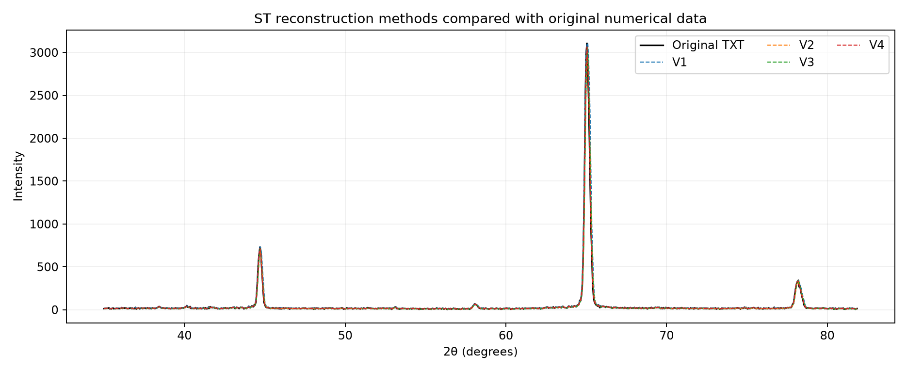
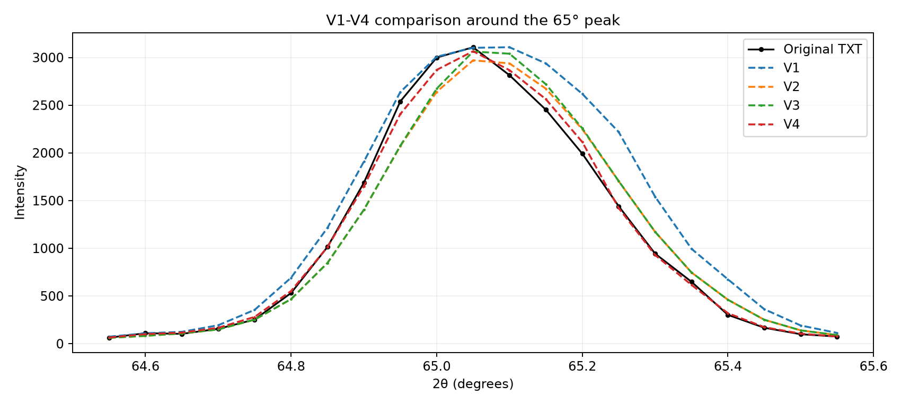
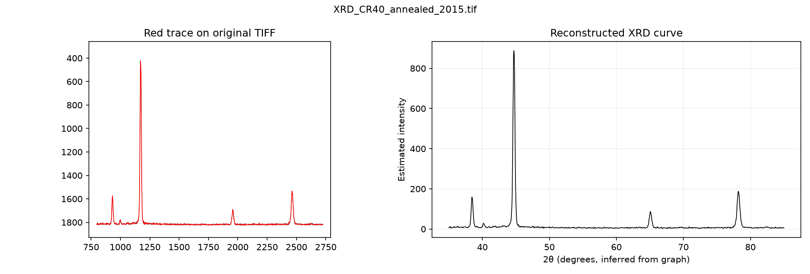

# Al6063 XRD TIFF digitization

This repository reconstructs numerical XRD profiles from five archived Al6063 TIFF plots. The solution-treated sample also has an original numerical TXT export, which is used to compare four experimental extraction methods.

## Repository structure

- `01_original_data` contains the original TXT export and five TIFF plots.
- `02_experiments` contains the code, reconstructed CSV, and validation outputs for V1, V2, V3, and V4.
- `03_version_comparison` compares V1-V4 with the original TXT data and with each other.
- `04_batch_v4_code` contains the V4 script scaled to process all five TIFF plots.
- `05_batch_v4_outputs` contains the batch results copied from the archived Drive folder.

---

## Abstract

Archived X-ray diffraction (XRD) plots can be digitized to recover numerical intensity profiles. This study reconstructed five Al6063 scans from TIFF images and validated the solution-treated reconstruction by comparing lattice parameters with those calculated from the original scan. The estimates agreed within 0.0047% across three methods. A batch notebook automates all three calculations for multiple XRD scans and consolidates the results in a single table.

## Reconstruction study

### 1. Problem statement and objective

Five X-ray diffraction (XRD) patterns from an earlier Al6063 aluminium study were available as TIFF plots, but the original numerical measurements could only be recovered for the solution-treated (ST) sample.

The objective was to reconstruct the underlying diffraction profiles from these images while preserving the peak positions, intensities and widths required for subsequent analysis.

A Python-based image digitization approach was developed and refined over four versions. The surviving ST numerical dataset provided a reference for measuring reconstruction errors and selecting the final method.

### 2. Method development: V1 to V4

The extraction process involves identifying the plotted diffraction curve, converting image pixels into calibrated 2θ and intensity values, and interpolating the recovered profile onto a regular angular grid.

Four approaches were evaluated incrementally:

| Version | Approach | Modification |
|---|---|---|
| **V1** | Upper-edge extraction | Selected the uppermost dark pixel in each image column |
| **V2** | Median-pixel extraction | Replaced the upper edge with the median dark-pixel position to reduce errors introduced by line thickness |
| **V3** | Peak-tip correction | Introduced localized corrections around sharp diffraction maxima to improve peak-height recovery |
| **V4** | Skeleton-based reconstruction | Extracted the curve centerline using morphological skeletonization, refined axis calibration and retained adaptive peak-tip correction |

V1 tended to overestimate intensity along steep peak shoulders. V2 improved the overall curve shape, while V3 recovered peak maxima more accurately but offered limited improvement in total reconstruction error. V4 substantially reduced both pointwise errors and peak-width deviations.

### 3. Quantitative validation

All four versions were benchmarked against the original Bruker numerical XRD measurements of the **ST sample**, acquired on 8 June 2015.

The reference contains **938 measurements**, spanning **35.00°–81.85°** at **0.05° intervals**. The instrument records Cu Kα1 radiation with a wavelength of **1.5406 Å**.

The original numerical TXT data were used to evaluate the reconstructed profiles, not as an input to the image-extraction algorithms. Because this same reference guided method development, the reported comparison represents a development benchmark rather than independent validation.

#### Overall reconstruction errors

| Metric | V1 | V2 | V3 | V4 |
|---|---:|---:|---:|---:|
| Mean absolute error (MAE) ↓ | 8.758 | 6.622 | 6.545 | **3.162** |
| Root mean square error (RMSE) ↓ | 48.884 | 29.693 | 29.930 | **9.244** |
| Pearson correlation ↑ | 0.98926 | 0.99209 | 0.99191 | **0.99924** |
| R² ↑ | 0.95678 | 0.98405 | 0.98380 | **0.99845** |
| Total intensity error (%) | +16.52 | −3.77 | −2.71 | **+0.61** |

*MAE and RMSE are expressed in intensity units. Total intensity error is the relative difference between summed reconstructed and measured intensities.*

V4 reduced MAE by approximately **64% relative to V1** and RMSE by approximately **81%**.



*Figure 1. Original ST diffraction profile compared with reconstructions from V1 to V4.*

### 4. Final V4 results

V4 was retained as the final method based on its overall reconstruction accuracy and its ability to reproduce the geometry of the principal diffraction peaks.

The final ST reconstruction achieved an **R² of 0.99845**, a **Pearson correlation of 0.99924**, and an **MAE of 3.16 intensity units** across the complete scan.

The three principal reflections also showed close agreement with the original measurements:

| Reflection | Peak position error | Peak height error | FWHM error | Integrated area error |
|---|---:|---:|---:|---:|
| (200) | 0.00° | −2.51% | +1.42% | −0.09% |
| (220) | 0.00° | −1.35% | +0.37% | −0.80% |
| (311) | 0.00° | −2.65% | +0.33% | +0.57% |

The principal peak positions matched exactly on the 0.05° evaluation grid. Peak widths were calculated using the half-prominence method, while integrated areas were estimated after local background subtraction.



*Figure 2. Comparison around the (220) reflection near 65°, showing the improvement in peak-shape reconstruction.*

The weaker feature near 58° remained less reliable, with a 0.05° position difference and an 8.88% integrated-area error. The plotted image also cannot preserve the complete statistical information present in the original detector measurements.

### 5. Extension to other Al6063 samples

After selecting V4, the method was extended to all five available TIFF plots using a shared extraction procedure and sample-specific vertical-axis calibrations.

| Sample | Reconstructed points | Angular range |
|---|---:|---|
| Solution-treated (ST) | 938 | 35.00°–81.85° |
| Cryorolled (CR40) | 1,001 | 35.00°–85.00° |
| CR40 + annealed | 1,001 | 35.00°–85.00° |
| UDR85 | 1,001 | 35.00°–85.00° |
| UDR85 + annealed | 1,001 | 35.00°–85.00° |

For the four samples without original numerical data, reconstruction quality was assessed by overlaying the extracted curves on their respective source TIFF images. The main diffraction peaks were reproduced satisfactorily, although a localized peak-tip artifact was identified in UDR85 near 78.25°.



*Figure 3. Example of image-level reconstruction quality assessment for the annealed CR40 sample.*

The batch-generated CSV files were also compared with the previously archived extraction results, confirming exact numerical reproducibility.

### 6. Scientific relevance and limitations

The reconstructed profiles provide a numerical basis for comparing diffraction peak positions, widths and relative intensities across the five processing conditions.

Notable differences in relative peak intensities are visible between the rolled and annealed specimens. These may be relevant to preferred crystallographic orientation and texture evolution, but intensity differences alone are insufficient to establish a specific texture change.

Peak broadening may also contain information about crystallite size and lattice microstrain. Quantitative interpretation, however, would require suitable peak-profile fitting, instrumental broadening corrections and uncertainty assessment.

**The principal outcome is a validated image-to-numerical reconstruction workflow**, with quantitative accuracy established for ST and image-level quality checks for the remaining four samples. The resulting datasets are suitable for exploratory diffraction analysis, subject to the limitations of recovering measurements from plotted images.

### 7. Lattice-parameter validation and batch analysis

The [batch notebook](06_lattice_parameter_notebook/Lattice_parameter_construction_bulk.ipynb) reads the shared Cu Kα₁ wavelength (1.5406 Å) and doublet settings once from the original ST TXT header. For each reconstructed CSV, it fits the FCC (200), (220) and (311) reflections and uses Bragg’s law to estimate the lattice parameter by three methods. It processes multiple XRD files acquired with the same settings in one run and exports one table.

| Sample | Arithmetic mean (Å) | Nelson–Riley (Å) | Cohen-style least squares with Nelson–Riley correction (Å) |
|---|---:|---:|---:|
| ST | 4.054361 | 4.053861 | 4.053963 |
| CR40 | 4.052420 | 4.052331 | 4.052622 |
| CR40 annealed | 4.053312 | 4.052320 | 4.052584 |
| UDR85 | 4.051311 | 4.050562 | 4.051404 |
| UDR85 annealed | 4.054511 | 4.053298 | 4.053074 |

To validate the reconstruction, the original ST scan and its reconstructed profile were fitted separately using the same procedure. Their lattice-parameter estimates differed by **0.000024–0.000187 Å** (at most **0.0047%**). ST was the only sample with an original numerical scan available for this comparison. See the [validation results](07_lattice_parameter_results/README.md) for the method-by-method comparison.

---

## Run the project

```bash
python -m pip install -r requirements.txt

python 02_experiments/V1/run_v1.py
python 02_experiments/V2/run_v2.py
python 02_experiments/V3/run_v3.py
python 02_experiments/V4/run_v4.py

python 03_version_comparison/compare_versions.py
python 04_batch_v4_code/reconstruct_all_tiffs_v4.py
```

The original TXT file is used for validation only. The reconstruction scripts use the TIFF plots as their data source.
