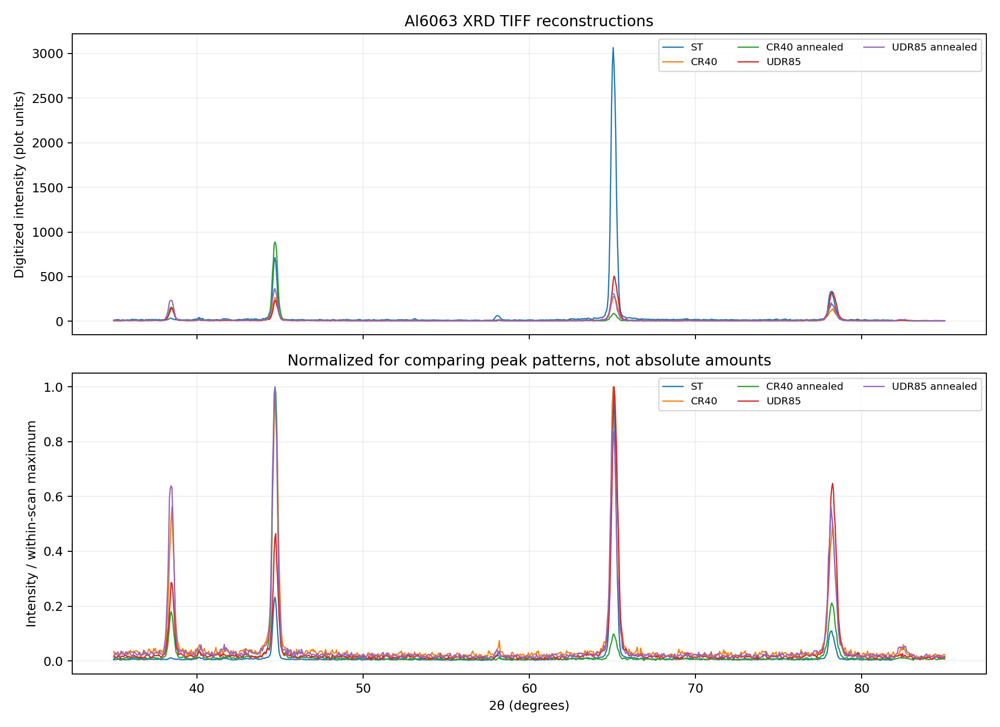
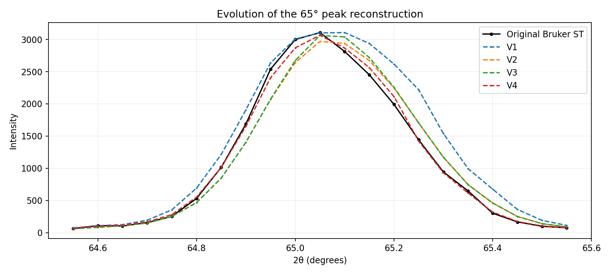

# From diffraction plots back to numbers: an Al6063 XRD digitization study

*An exploratory, reproducible reconstruction of historical X-ray diffraction measurements from TIFF plots.*



## The question

In an earlier study of processed Al6063 aluminium, five X-ray diffraction (XRD) patterns were saved as TIFF images. The original detector export survived for one condition—**solution treated (ST)**—but not for the four rolled or annealed conditions. A plotted curve is useful to look at, yet awkward to measure: where exactly is a diffraction peak, how wide is it, and how much intensity sits beneath it?

This project asks a practical question: **How much of an XRD scan can we recover from a graph image, and how can we tell whether the recovered numbers deserve to be trusted?**

The answer is tested with a useful accident of archiving. The ST specimen has both a TIFF plot and the original Bruker numerical export. We can reconstruct ST *from the image alone*, compare the result point by point with the instrument data, and use what we learn to digitize the other four TIFFs.

The work is a **method-development and data-recovery exercise**, not a new diffraction technique or a claim to have recovered the exact detector counts.

## Data and approach

The experiment includes five image records: ST, CR40, CR40 after annealing, UDR85, and UDR85 after annealing. All are 3390 × 2379-pixel TIFF plots. The sole original numerical record is the Bruker ST scan acquired on **8 June 2015**. Its header records Cu radiation (Cu Kα1 wavelength **1.5406 Å**) and **938 measured points**, from **35.00° to 81.85°** in **0.05° steps**. The instrument metadata identify a coupled 2θ scan.

Recovering the curve requires two translations. First, locate the black plotted line among the image pixels. Second, convert pixel coordinates into physical graph coordinates using the printed axis ticks. In this format, a horizontal position near pixel 606 represents 30°, and pixel 2918 represents 90°. Each TIFF needs its own *vertical* calibration: the charts use different intensity scales. We then interpolate the recovered curve onto a regular 0.05° grid and export a CSV.

The ST detector export is **not an input to any reconstruction routine**. It is used afterwards for validation. It also informed our choice of extraction method, so the ST evaluation is an *in-sample development benchmark*, not a blind, independent test.

### Four attempts, one measurable improvement

We kept each stage instead of replacing early code with the latest implementation:

| Version | How the curve is traced | ST MAE | ST RMSE | Pearson correlation |
|---|---|---:|---:|---:|
| **V1** | Uppermost black pixel in each image column | 8.758 | 48.884 | 0.98926 |
| **V2** | Median black pixel in each column | 6.622 | 29.693 | 0.99209 |
| **V3** | V2 with a local adjustment at sharp peak tips | 6.545 | 29.930 | 0.99191 |
| **V4** | Skeletonized centerline, revised tick calibration and peak-tip correction | **3.162** | **9.244** | **0.99924** |

*Errors are in the plotted intensity units, calculated over all 938 ST angle points. Lower MAE/RMSE is better. Correlation mostly measures similarity in shape; it does not imply that every count was recovered to 99.9% accuracy.*



V1 followed the *top edge of the ink*, which exaggerates steep peak shoulders. V2 traced the middle and brought peak widths much closer to the original. V3 restored some peak height but did not improve overall RMSE. V4 used a one-pixel **skeleton** of the line and slightly more accurate axis tick positions. This helped preserve the peak profile without relying on the original detector counts to fill it in.

### What V4 recovers—and what it misses

For the three strongest ST reflections, the extracted **peak positions coincide with the original 0.05° measurement grid**. Their reconstructed heights are approximately **1.3–2.7% lower** than the measured maxima. Under a consistent half-prominence definition, their FWHM differs by roughly **0.3–1.4%**. Integrated peak areas differ by about **0.1–0.8%**, using fixed peak windows and a simple locally interpolated background.

| Reflection (tentative Al assignment) | Raw 2θ | V4 2θ | V4 height error | V4 FWHM error | V4 area error |
|---|---:|---:|---:|---:|---:|
| (200) | 44.70° | 44.70° | −2.51% | +1.42% | −0.09% |
| (220) | 65.05° | 65.05° | −1.35% | +0.37% | −0.80% |
| (311) | 78.20° | 78.20° | −2.65% | +0.33% | +0.57% |

The complete ST validation gives **MAE 3.162**, **RMSE 9.244**, **R² 0.99845**, and a **+0.61% difference in total summed intensity** for standalone V4. The generalized batch method is effectively the same (**MAE 3.160**, RMSE **9.243**); one end-of-scan point differs because the batch version determines the visible line boundary automatically.

These strong global numbers have limits. On the weak feature near **58°**, the maximum shifts by **0.05°** and its locally integrated area differs by about **8.9%**. Fine counting noise and faint peaks cannot be reliably retrieved from the ink of a printed graph. The reported widths are *as-plotted widths*: no instrumental-broadening correction has been applied.

## Extending the method to all five plots

The batch pipeline applies the same tracing method to each TIFF, with calibration values measured separately for the intensity axis. ST yields **938 points**; each of the other four images yields **1,001 estimated points** on a 35°–85° grid. That grid is an export choice, **not proof of the original acquisition step** for those specimens.

| Condition | Prominent maximum near | Reconstructed max intensity | Status |
|---|---:|---:|---|
| ST | 65.05° | 3065.1 | Validated against archived detector values |
| CR40 | 65.10° | 275.3 | Image-level validation only |
| CR40, annealed | 44.70° | 888.3 | Image-level validation only |
| UDR85 | 65.10° | 506.6 | One isolated peak-tip tracing artifact |
| UDR85, annealed | 44.70° | 367.0 | Image-level validation only |

For the four non-ST samples, projecting the CSV coordinates back onto the TIFF indicates generally close agreement with the drawn curves. **UDR85 contains one exceptional point near 78.25°**, approximately **21 pixels** from the nearest dark plotted stroke. That point needs inspection or correction before reporting its local peak shape. The automated image QA file records this explicitly.

The relative heights change substantially across processing conditions. In the extracted plots, the approximate **(200)/(220) maximum-height ratio** changes from **0.23** (ST) to **0.96** (CR40), **10.27** (CR40 annealed), **0.46** (UDR85) and **1.19** (UDR85 annealed). This pattern is compatible with changes in preferred crystal orientation, but **not sufficient to quantify texture**. Diffracted intensity also depends on sample geometry, instrument settings, peak shape and several corrections. Comparing absolute intensities across these plots is especially risky without their original acquisition metadata.

### Independent rerun check

The code was executed afresh on the preserved TIFFs. Its **four ST version outputs exactly match the archived V1–V4 CSVs**. The generalized batch pipeline's five CSVs and QA summary are **byte-for-byte identical to the results independently saved in Google Drive** during the project. See [`analysis/drive_reproduction_check.csv`](analysis/drive_reproduction_check.csv), which records the SHA-256 comparisons. This establishes *reproducibility of the extraction*, not experimental correctness of the four unrecovered source scans.

## Run it yourself

The workflow uses **Python** with **NumPy** for pixel-to-number calculations, **Pillow** to read TIFFs, **scikit-image** for skeletonization, **SciPy** to locate peak tips and measure widths, **pandas** to assemble comparisons, and **Matplotlib** to show what happened. VS Code and Jupyter are convenient for exploration but not required; each stage also runs from the command line.

```bash
python3 -m venv .venv
source .venv/bin/activate    # Windows: .venv\Scripts\activate
python -m pip install -r requirements.txt

python scripts/unpack_tiffs.py
python scripts/reconstruct_st_versions.py
python scripts/reconstruct_batch_v4.py
python scripts/validate_and_analyze.py
python scripts/compare_samples.py
pytest -q
```

To verify a downloaded copy of the archived Drive results, run:

```bash
python scripts/verify_against_drive.py /path/to/downloaded-drive-results
```

The **five original TIFFs are preserved byte-for-byte in `data/raw/original_tiffs_lossless.zip`** (a lossless ZIP archive; ~180 KB rather than ~40 MB of uncompressed images). Run `unpack_tiffs.py` once to restore them to `data/raw/tiff/`. Their SHA-256 hashes are checked against the source manifest; the reconstruction scripts never overwrite them. The Bruker ST text export stays in `data/raw/instrument/`. Generated CSVs and plots are separated from sources so that rerunning the project is straightforward.

### Repository map

```text
.
├── README.md                         This report and the main entry point
├── data/
│   └── raw/
│       ├── original_tiffs_lossless.zip  Five untouched TIFFs (unpack once)
│       ├── tiff/                    Extracted TIFFs; not separately committed
│       └── instrument/              Surviving ST Bruker export (RAW4.00 text)
├── src/
│   └── st_versions.py               Reconstruct V1, V2, V3 and V4
├── scripts/
│   ├── unpack_tiffs.py             Extract and hash-check the source TIFFs
│   ├── reconstruct_st_versions.py    Re-run and save the four ST experiments
│   ├── reconstruct_batch_v4.py      Generalized five-sample V4 extractor
│   ├── validate_and_analyze.py      Compare ST with raw data; check image tracing
│   ├── compare_samples.py           Descriptive plots and peak ratios
│   └── verify_against_drive.py      Optional independent Drive-results check
├── experiments/st_versions/         Four ST CSVs, errors and evolution plots
├── results/batch_v4/                Five final CSVs, QA overlays and QA summary
├── analysis/                        Validation tables, image QA, sample comparisons
├── tests/                           Smoke tests and ST accuracy regression
└── requirements.txt                 Python dependencies
```

For orientation, begin with the [four-version peak comparison](experiments/st_versions/st_220_peak_comparison.png), then examine the five `*_QA.png` files in [`results/batch_v4/`](results/batch_v4/). A red trace that visibly leaves the black graph is a reason to **stop and inspect the corresponding CSV**, not a reason to smooth the artifact away without recording it.

## What the reconstruction can—and cannot—tell us

The practical result is a set of **five numerical approximations** that can be plotted, compared and subjected to preliminary peak identification. The ST result demonstrates that a carefully calibrated image-processing workflow can recover the main positions, widths and areas of strong peaks with low error on this plotting style. The four other reconstructions preserve many visible features, but their **unknown measurement-level error** cannot be inferred from ST's accuracy alone.

The next meaningful steps are independent validation on other TIFFs with known raw scans, uncertainty bounds under small changes to pixel calibration and stroke threshold, and manual review of the UDR85 artifact. Any claims about crystallite size, microstrain, phase fractions or quantitative texture require more than this recovered plot data, including suitable instrumental correction and metadata.

**Data note.** The images and instrument export are preserved from an earlier Al6063 experimental archive. Their inclusion here does not establish publication rights or a license for onward redistribution; check permissions before making the repository public. The reconstruction code and derived files do not replace the underlying measurements.
